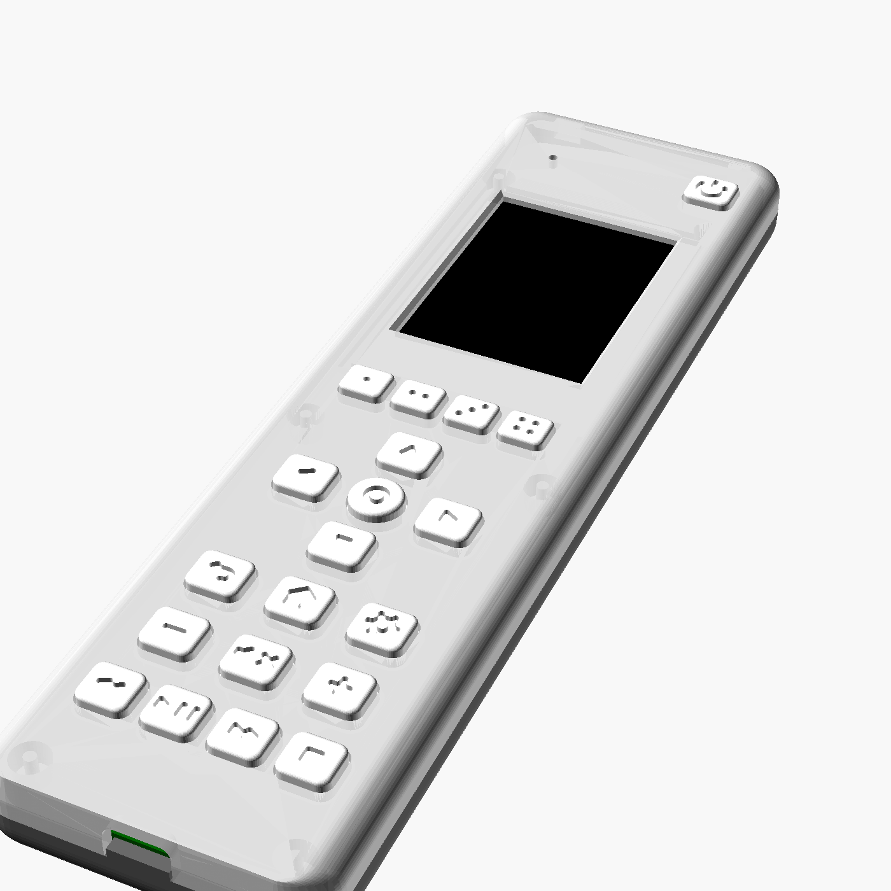

<h1 align="center">
  <picture>
    <source media="(prefers-color-scheme: dark)" srcset="docs/brand/param-key-logo-dark-256.png">
    
  </picture>
</h1>

**The physical remote for Home Assistant. If HA can control it, so can this.**

<!-- hero: photo of the remote in hand, screen on. Then a 20-second clip: one press, something in the room reacts. -->


PARAM KEY has twenty real buttons and a screen, and it has no device database of its own. Home Assistant
does the thinking, so it controls everything your HA already does: media, lights, climate, scenes,
scripts. An IR blaster covers the gear HA can't reach.

**[→ Join the beta list](https://paramworks.com)** · [Discuss on the Home Assistant forum](https://community.home-assistant.io/t/param-key-a-smart-universal-remote-for-home-assistant-esphome-physical-buttons-screen-ir/1031837)

## Why it's different

- **HA is the device list.** Give an entity the label `remote` and it shows up on the remote. Remap a
  key in HA, and it takes effect without a reflash.
- **Hotkeys that follow context.** Four keys are labelled live on the screen: now playing, the
  current room, the current mode.
- **Local, no cloud.** It uses ESP-NOW to reach a bridge, which is any ~$10 ESP32, flashed from your
  browser. The remote never joins your Wi-Fi.
- **Secure by default.** Every key press is encrypted and authenticated with the remote's own key,
  and a recorded press can't be played back. Pairing shows the same 6-digit code on the remote and
  in Home Assistant.
- **Weeks per charge.** It sleeps on the table and wakes when you pick it up: 2–3 weeks on a
  1000 mAh cell, charged over USB-C. Its battery level reaches HA on every wake.
- **IR for the rest.** A blaster for gear HA can't reach, sending codes from Home Assistant's own IR
  library, so HA's IR integrations can use it too. v2 adds a receiver to learn codes from the remote
  it replaces.
- **Yours to hack.** The ESPHome firmware and the HA integration are MIT.

## Status

| | |
|---|---|
| Remote v1 | In daily use |
| Remote v2 | Boards in fab: fuel gauge, IR receiver, proper charge termination, sturdier case (FEA-checked). Its firmware follows the boards |
| HACS integration ([param-key-homeassistant](https://github.com/paramworks-git/param-key-homeassistant)) | Bridges, pairing, IR, menus from labels, battery and settings. Next: a guided media setup |
| IR learning | With v2: the receiver is on the board, the learning software comes next |
| Room awareness | Next: one bridge per room, and the remote switches layout to the nearest one |

## How it works

```
 PARAM KEY  ──ESP-NOW──▶  bridge (ESPHome)  ──API──▶  Home Assistant  ──▶  your devices
    ▲                                                     │
    └──────────── screen content, hotkey labels ──────────┘
```

The remote sends key presses (press, long press, repeat) and shows whatever HA sends back. All
mapping lives in HA, so the firmware stays generic.

| Inside | v1 | v2 |
|---|---|---|
| MCU | ESP32-S3, ESPHome | same |
| Screen | 2.0" 240×320 | same |
| Keys | 20: power, 4 hotkeys, d-pad, back/home/settings, volume, media | same |
| Radio | ESP-NOW to the bridge: two-way, acknowledged, encrypted | same |
| IR | 940 nm blaster | blaster, plus a 38 kHz receiver for learning codes |
| Battery level | Estimated from the cell voltage (within about 5 %) | MAX17048 fuel gauge |
| Charging | LiPo over USB-C | LiPo over USB-C, with load sharing, so charging finishes properly and HA sees when USB is plugged in |
| Wake | Any key, or picking it up (accelerometer) | same |

`hardware/` has v2's schematic, pinout, parts list and case models.

## Set up

You need Home Assistant 2026.10 or later with [HACS](https://hacs.xyz), a 2.4 GHz Wi-Fi network,
and any ESP32 board for the bridge.

1. **Bridge:** open the [installer](https://paramworks-git.github.io/param-key/) in Chrome or Edge,
   plug the ESP32 into your computer, select **Install bridge** and enter your Wi-Fi.
2. **Home Assistant:** in HACS, add `paramworks-git/param-key-homeassistant` as a custom repository
   (type Integration), download **PARAM KEY**, and restart Home Assistant. Under Settings → Devices &
   services → Discovered, add the ESPHome device `param-key-bridge-…`, then **PARAM KEY**.
3. **Remote:** switch it on. It shows up as discovered too: add it, and check that the 6-digit code
   in Home Assistant matches the one on its screen.

Set your access point's 2.4 GHz channel to a fixed one (1, 6 or 11) rather than auto: the remote
learns the bridge's channel when it pairs. Bridge updates show up in Home Assistant; remotes update
over USB from the installer.

## Repository

| Path | What | Licence |
|---|---|---|
| [`firmware/`](firmware/) | ESPHome configs for the remote and the bridge; building, releasing, troubleshooting | MIT |
| [`components/param_key/`](components/param_key/) | The ESPHome component they share: link, crypto, pairing, screen | MIT |
| [`docs/`](docs/) | Radio protocol, test vectors | MIT |
| [`site/`](site/) | The installer page (published with each release) | MIT |
| [`hardware/`](hardware/) | Schematic, pinout, parts list, case models and renders, FEA | All rights reserved |

The Home Assistant integration lives in its own repository,
[param-key-homeassistant](https://github.com/paramworks-git/param-key-homeassistant), so HACS can
install it. `hardware/` is generated from the private hardware sources and replaced on every export.

## Get one

A small beta batch is coming. **[Join the list](https://paramworks.com)**: it only takes your email.
Questions and ideas: the [forum thread](https://community.home-assistant.io/t/param-key-a-smart-universal-remote-for-home-assistant-esphome-physical-buttons-screen-ir/1031837), or Issues and Discussions here.
